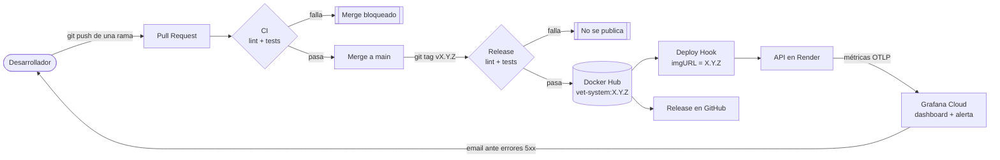

# VetSystem

Sistema de gestión para la clínica veterinaria "Patitas Felices".
Universidad de Palermo, 2026. El repositorio se utiliza en dos materias:

- **Microservicios y APIs Escalables**: desarrollo de la API REST (sprints y parcial).
- **DevOps**: Trabajo Práctico Integrador sobre el ciclo de vida y despliegue continuo de la API. El [informe técnico](#informe-técnico--tp-integrador-devops) está en este mismo documento.

## Integrante

- Martin Marchetto

## Enlaces

| Recurso | URL |
| --- | --- |
| API desplegada (Render) | https://vet-system-1-0-0.onrender.com |
| Documentación interactiva (Swagger UI) | https://vet-system-1-0-0.onrender.com/swagger-ui/index.html |
| Imagen en Docker Hub | https://hub.docker.com/r/martinmarchetto/vet-system |
| Releases | https://github.com/marttinm/vetSystem-martin-marchetto/releases |
| Registro de evidencias del TP | [docs/devops/evidencias.md](docs/devops/evidencias.md) |

El servicio de Render usa el plan Free: después de 15 minutos sin tráfico se apaga, y el primer pedido tarda unos 2 minutos en despertarlo.

## Stack

- Java 21
- Spring Boot 4.1.0 (Web MVC, Data JPA, Validation, Actuator)
- PostgreSQL 14
- springdoc-openapi (Swagger UI)
- Lombok y MapStruct
- Maven y Checkstyle
- Docker y Docker Compose
- GitHub Actions, Docker Hub, Render y Grafana Cloud

## Cómo levantarlo

### Con Docker

Requiere Docker Desktop corriendo.

1. Crear el archivo de variables de entorno a partir del ejemplo y definir una contraseña:

```bash
cp .env.example .env
```

2. Levantar la API y la base de datos:

```bash
docker compose up --build
```

La API queda en http://localhost:8080 y Swagger UI en http://localhost:8080/swagger-ui/index.html. Para apagar todo, `docker compose down`; para borrar también los datos de la base, `docker compose down -v`.

### Sin Docker

1. Crear la base de datos:

```sql
CREATE DATABASE vet_system;
```

2. La configuración se toma de variables de entorno. Si no se definen, se usan estos valores por defecto:

| Variable | Valor por defecto | Uso |
| --- | --- | --- |
| `DB_URL` | `jdbc:postgresql://localhost:5432/vet_system` | Conexión a la base |
| `DB_USERNAME` | `magic` | Usuario de la base |
| `DB_PASSWORD` | (vacío) | Contraseña de la base |
| `OTLP_METRICS_ENABLED` | `false` | Activa el envío de métricas a Grafana Cloud |
| `OTLP_METRICS_URL` | `http://localhost:4318/v1/metrics` | Endpoint OTLP de métricas |
| `OTLP_METRICS_AUTH` | (vacío) | Header `Authorization` del endpoint OTLP (`Basic <token>`) |

3. Levantar la aplicación:

```bash
cd vet-system
./mvnw spring-boot:run
```

Las tablas las crea Hibernate al iniciar, con `ddl-auto=update`.

### Tests y linter

```bash
cd vet-system
./mvnw test              # requiere la base de datos para VetSystemApplicationTests
./mvnw checkstyle:check
```

## API

La documentación completa de los endpoints está en Swagger UI. Los recursos son:

| Recurso | Ruta base |
| --- | --- |
| Dueños | `/api/duenios` |
| Mascotas | `/api/mascotas` |
| Veterinarios | `/api/veterinarios` |
| Turnos | `/api/turnos` |
| Medicamentos | `/api/medicamentos` |

```bash
curl -X POST http://localhost:8080/api/duenios \
  -H 'Content-Type: application/json' \
  -d '{"nombre":"Martin","apellido":"Marchetto","dni":"12345678","telefono":1155551234,"email":"martin@test.com"}'
```

## Modelo de dominio

- **Duenio** (1) —< (N) **Mascota**: un dueño tiene muchas mascotas.
- **Turno** —> **Mascota** y **Turno** —> **Veterinario**: cada turno es de una mascota con un veterinario.
- **Turno** >—< **Medicamento**: un turno puede recetar varios medicamentos.

El diagrama de clases está en `docs/diagrama.png` y el screenshot de las tablas creadas en `docs/tablas.png`.

## Estructura

```
vet-system/src/main/java/com/vetSystem/
├── Controller/   endpoints REST
├── Service/      lógica de negocio
├── Repository/   interfaces de Spring Data
├── Entity/       entidades JPA
├── Dto/          objetos de entrada y salida de la API
├── Mapper/       conversión entre entidades y DTOs (MapStruct)
├── Exception/    excepciones y manejo global de errores
└── config/       Swagger, CORS y logging de requests
```

---

# Informe técnico — TP Integrador DevOps

## 1. Arquitectura del pipeline

### Diagrama de flujo



Cada cambio entra por un Pull Request y solo llega a `main` si el linter y los tests pasan. Al crear un tag SemVer, el pipeline de release vuelve a verificar el código, publica la imagen con ese tag, despliega exactamente esa versión en Render y genera la Release en GitHub. En producción, la app envía métricas a Grafana Cloud, que alerta por email si aparecen errores 5xx.


### Componentes

| Etapa | Herramienta | Función |
| --- | --- | --- |
| Control de versiones | Git + GitHub | Ramas cortas, Pull Requests y protección de `main` |
| Linter | Checkstyle | Imports sin uso, bloques vacíos, `equals` sin `hashCode`, tabs, entre otras reglas |
| Tests | JUnit 5, Mockito y MockMvc | Tests de servicios, de controllers, del manejo de errores, de los logs y de la configuración de métricas |
| Runner de CI | GitHub Actions | Ejecuta los workflows en cada PR y en cada tag |
| Registro de imágenes | Docker Hub | Imagen `martinmarchetto/vet-system` etiquetada con la versión SemVer |
| Hosting | Render (plan Free) | Servicio web desde la imagen de Docker Hub y PostgreSQL 14 gestionado |
| Monitoreo | Grafana Cloud | Métricas vía OTLP, dashboard de Golden Signals y alerta por email |

### Workflows

Los workflows son modulares: lint, tests, publicación y despliegue se definen una sola vez como workflows reutilizables (`on: workflow_call`) y se combinan en los dos flujos principales.

| Workflow | Disparador | Qué hace |
| --- | --- | --- |
| `ci.yml` | Pull Request hacia `main` | Llama a `lint.yml` y `test.yml` en paralelo |
| `release.yml` | Push de un tag `v*.*.*` | Lint + tests → `docker-publish.yml` → `deploy-render.yml` y Release en GitHub |
| `lint.yml` | Reutilizable | `./mvnw checkstyle:check` |
| `test.yml` | Reutilizable | `./mvnw test` con un service container de PostgreSQL 14 |
| `docker-publish.yml` | Reutilizable | Build de la etapa `runtime` del Dockerfile y push a Docker Hub con el tag de la versión |
| `deploy-render.yml` | Reutilizable | Llama al Deploy Hook de Render con `imgURL` apuntando a la imagen de la release |

## 2. Justificación técnica y decisiones de diseño

### Optimización del contenedor

El [Dockerfile](vet-system/Dockerfile) usa una compilación en dos etapas:

```dockerfile
FROM maven:3.9.9-eclipse-temurin-21-alpine AS build
WORKDIR /app
COPY pom.xml .
RUN mvn dependency:go-offline -B
COPY src ./src
RUN mvn package -DskipTests -B

FROM eclipse-temurin:21-jre-alpine AS runtime
WORKDIR /app
RUN addgroup -S spring && adduser -S spring -G spring
COPY --from=build --chown=spring:spring /app/target/*.jar app.jar
USER spring
EXPOSE 8080
ENTRYPOINT ["java", "-jar", "app.jar"]
```

- **Multi-stage**: la etapa `build` tiene Maven y el JDK completo; la etapa `runtime` solo tiene el JRE y el `.jar`. La imagen final pesa 266 MB (120,7 MB comprimida en Docker Hub), mientras que solo la imagen base de la etapa de build pesa 386 MB, sin contar las dependencias descargadas.
- **Imagen base ligera y específica**: variantes `alpine` con versiones fijas. No se usa el tag `latest`, así que el build es reproducible.
- **Caché de capas**: se copia primero el `pom.xml` y se descargan las dependencias, y recién después se copia el código. Si cambia el código pero no el `pom.xml`, la descarga de dependencias sale de la caché (ver la evidencia en [evidencias.md](docs/devops/evidencias.md#dockerfile)). En CI, el build usa además la caché de GitHub Actions.
- **Usuario sin privilegios**: la app corre con el usuario `spring` (`docker compose exec app whoami` responde `spring`). Si alguien comprometiera la app, no tendría permisos de root dentro del contenedor.
- **Tests fuera del build de la imagen** (`-DskipTests`): los tests ya corren en CI antes de publicar, con una base de datos real. Repetirlos dentro del build alargaría cada construcción sin agregar verificación.

`docker-compose.yaml` levanta la API y PostgreSQL 14 con un solo comando. La base tiene un healthcheck y la API espera a que esté `healthy` antes de arrancar.

### Estrategia de integración

- **Trunk-Based Development**: `main` es la única rama permanente. Cada cambio se trabaja en una rama corta (`feat/`, `fix/`, `ci/`, `docs/`, `build/`) y se integra por Pull Request. Es el modelo más simple para un proyecto individual y favorece entregas en lotes pequeños.
- **Protección de `main`**: exige Pull Request y los checks `lint / Checkstyle` y `test / Tests` en verde, sin excepciones para el administrador y sin force push. No se exigen aprobaciones porque GitHub no permite aprobar los PRs propios y, con un único desarrollador, bloquearía todos los merges.
- **Pull Requests documentados**: cada PR incluye una descripción del cambio y una sección "Evidencia de pruebas" con la salida de los tests o de la verificación manual.
- **Conventional Commits**: `feat:`, `fix:`, `docs:`, `ci:`, `build:`, `style:`, `refactor:`. Las excepciones del historial están documentadas en [evidencias.md](docs/devops/evidencias.md#conventional-commits).
- **SemVer**: el tipo de commit define la versión. `feat` sube el MINOR, `fix` sube el PATCH, y `ci`/`docs` no generan versión por sí solos. El tag de Git `vX.Y.Z` se publica en Docker Hub como `vet-system:X.Y.Z`.

## 3. Aplicación de la filosofía DevOps

### Primera Forma: flujo y consistencia

**Tareas que quedaron 100% automatizadas:**

| Tarea | Antes (manual) | Ahora |
| --- | --- | --- |
| Verificar estilo y tests | Correrlos a mano antes de integrar | `ci.yml` en cada PR, obligatorio para el merge |
| Construir la imagen | `docker build` local | `docker-publish.yml` al crear un tag |
| Etiquetar la versión | Elegir y escribir el tag de la imagen | Se toma del tag de Git |
| Publicar en el registro | `docker push` con credenciales locales | Push desde el pipeline, con un token guardado como secret |
| Desplegar | Actualizar el servicio en Render a mano | Deploy Hook con la imagen exacta de la release |
| Notas de la release | Escribirlas a mano | Generadas a partir de los PRs incluidos |

Desde que se pushea un tag hasta que la nueva versión está publicada pasan unos 3 minutos, más los aproximadamente 2 minutos que tarda Render en arrancar la instancia.

**Cómo se asegura que el entorno sea el mismo en desarrollo y en CI/CD:**
- La imagen que corre en Render es la misma que se construye con el Dockerfile versionado, y `docker compose up --build` usa ese mismo Dockerfile en local.
- Render despliega una imagen por su tag exacto (`imgURL`), no "la última".
- Las versiones están fijadas y son iguales en todos los entornos: Java 21 (Temurin) y PostgreSQL 14 en local, en el compose, en el CI y en Render.
- La configuración que cambia entre entornos (base de datos y monitoreo) se toma de variables de entorno, con el mismo código en todos lados.

### Segunda Forma: feedback rápido y Andon Cord

**Puntos donde el flujo se corta:**
1. **Linter en el PR**: si Checkstyle encuentra violaciones, falla el job `lint / Checkstyle`.
2. **Tests en el PR**: si un test falla, falla el job `test / Tests`.
3. **Protección de `main`**: con cualquiera de los dos checks en rojo, el botón de merge queda deshabilitado.
4. **Release**: el workflow de release vuelve a correr lint y tests sobre el código del tag. Si fallan, no se publica la imagen ni se despliega.


**Visibilidad de fallos en producción:**

| Problema | Herramienta | Señal |
| --- | --- | --- |
| La API responde errores 5xx | Grafana Cloud | **Alerta** "Errores 5xx en la API": se dispara con errores 5xx sostenidos durante 1 minuto y avisa por email. También se ve en el panel de errores 5xx. |
| Latencia alta | Grafana Cloud | **Métrica**: panel de latencia p50/p95, calculado con el histograma de `http.server.requests`. |
| Aumento de errores del cliente | Grafana Cloud | **Métrica**: panel de errores 4xx, separado por código. |
| Diagnóstico de un request puntual | Logs de Render | **Log** JSON por request con `timestamp`, `level`, `method`, `path`, `status_code` y `duration_ms`. |


### Tercera Forma: aprendizaje y simulación de fallos

**Experimento 1: test roto a propósito** ([PR #11](https://github.com/marttinm/vetSystem-martin-marchetto/pull/11)). Se cambió el valor esperado de un test de `"Carlos"` a `"Carlos1"`. El job `test / Tests` falló, la regla de protección deshabilitó el merge y el PR se cerró sin integrar. El error se detuvo antes de llegar a `main`, sin depender de una revisión manual.

**Experimento 2: errores 5xx en producción.** Se envió tráfico a la API desplegada con ids que no son números (`/api/duenios/abc`). La alerta pasó a *Pending* al detectar errores 5xx y a *Firing* después de 1 minuto, y envió el email. Así salió a la luz un error que los tests no cubrían: un parámetro con tipo inválido se respondía como 500 en lugar de 400. Se corrigió en el [PR #24](https://github.com/marttinm/vetSystem-martin-marchetto/pull/24), con un test nuevo que fija el comportamiento. El fix salió en la release `v1.1.2`: la misma ruta pasó a responder 400 y, sin errores 5xx, la alerta volvió sola a *Normal*.

**Incidentes reales y lo que se aprendió:**
- **Variable de entorno faltante en Render**: en el primer despliegue, `DB_USERNAME` no estaba bien cargada y la app intentó conectarse con el usuario por defecto del entorno local (`magic`). Los valores por defecto pensados para desarrollo ocultaron que faltaba la variable.
- **Falla silenciosa del monitoreo**: con la `v1.1.0` desplegada, las métricas no llegaban porque faltaba el módulo `spring-boot-opentelemetry`, y Spring descartaba el exportador sin registrar errores. Se detectó solo al mirar Grafana, se corrigió en el [PR #23](https://github.com/marttinm/vetSystem-martin-marchetto/pull/23) y se agregó un test para que no vuelva a pasar.
- **Errores del cliente reportados como 500**: al probar la API desplegada se encontraron tres casos más (ruta inexistente, JSON mal formado y método no soportado), corregidos en los PRs [#17](https://github.com/marttinm/vetSystem-martin-marchetto/pull/17), [#18](https://github.com/marttinm/vetSystem-martin-marchetto/pull/18) y [#19](https://github.com/marttinm/vetSystem-martin-marchetto/pull/19). Sin esos arreglos, la señal de errores 5xx del dashboard habría mezclado fallas del servidor con pedidos mal hechos.
- **Falsas alarmas del monitoreo**: el historial de la alerta mostró evaluaciones fallidas porque Grafana Cloud no lograba conectarse a su propio Prometheus (`i/o timeout`). Con la configuración por defecto, esas fallas ponían la regla en *Error* y podían mandar un email aunque la API funcionara bien. Una alerta que suena sin motivo deja de tomarse en serio, así que la regla ahora mantiene su último estado cuando la evaluación falla.

## 4. Principios Lean (reducción de desperdicio)

| Desperdicio | Cómo aparecía | Cómo lo evita la solución |
| --- | --- | --- |
| **Esperas y pasos manuales** para empaquetar y desplegar | Compilar, construir la imagen, etiquetarla, subirla y actualizar el servidor eran pasos manuales, lentos y propensos a errores, como subir la versión equivocada. | Un `git push` del tag dispara todo el flujo. La versión publicada y la desplegada salen del mismo tag, sin pasos intermedios. |
| **Defectos detectados tarde** | Un error que llega a producción se descubre cuando ya afecta a los usuarios y cuesta más corregirlo. | Linter y tests obligatorios en cada PR, el mismo control en la release y una alerta en producción. El PR #11 se frenó antes del merge, y el error del PR #24 se detectó por la alerta y volvió como test. |
| **Configuración manual de entornos** ("en mi máquina funciona") | Instalar y configurar a mano Java, PostgreSQL y las variables en cada entorno genera diferencias difíciles de rastrear. | Dockerfile y `docker-compose.yaml` versionados, configuración por variables de entorno y versiones fijas. El entorno completo se levanta con un comando. |

Además, el trabajo se entregó en **lotes pequeños**: cada PR resuelve un único cambio (un fix, un workflow, una parte de la observabilidad), lo que hace más fácil revisarlo, probarlo y revertirlo si hace falta.

## 5. Evidencias

El registro completo, con salidas de comandos, capturas y los problemas encontrados en cada fase, está en [docs/devops/evidencias.md](docs/devops/evidencias.md).

---

# Microservicios y APIs Escalables

## Parcial 1 — Decisiones de diseño

### Relación Turno–Medicamento

Es una relación `@ManyToMany` unidireccional desde `Turno`, con la tabla intermedia `turno_medicamentos (turno_id, medicamento_id)`. Un turno puede recetar varios medicamentos y un medicamento aparece en muchos turnos. La hice unidireccional porque solo necesito ir del turno a sus medicamentos y desde `Medicamento` nunca consulto en qué turnos se usó.
El esquema lo genera Hibernate con `ddl-auto=update`, que crea tablas y columnas nuevas sin borrar datos. Sirve para desarrollo, pero en producción usaría Flyway o Liquibase, porque `update` no elimina columnas viejas ni deja registro de los cambios.
No usé una entidad intermedia porque no necesito guardar datos de la receta como dosis o cantidad, si hicieran falta, migraría a esa opción.

### Validación de stock

Está en `TurnoService.agregarMedicamento` y no en el controller, porque es una regla de negocio. Busco el turno y el medicamento, si alguno no existe, lanzo `ResourceNotFoundException` 404. Si el stock es 0, lanzo `BusinessRuleException`, y el `GlobalExceptionHandler` la devuelve como 422 indicando qué medicamento no tiene stock.
Si hay stock, descuento una unidad y asocio el medicamento al turno dentro de un `@Transactional`, así se guardan las dos cosas o ninguna.
Una limitación es que dos pedidos simultáneos podrían leer el mismo stock, lo resolvería con bloqueo optimista usando `@Version`.

### Solapamiento

Se valida en `TurnoService.createTurno` antes de guardar. Uso `findFirstByVeterinarioIdAndFechaAndHora`, que compara veterinario, fecha y hora exactas. Antes tenía un `existsBy...`, pero devolvía solo un booleano y la consigna pide informar cuál es el turno en conflicto, así que lo cambié por un `findFirstBy...` que devuelve `Optional<Turno>`. Si viene con valor, lanzo `TurnoSuperpuestoException` 409 con el id, la fecha y la hora del turno que choca. Como comparo la hora exacta, no detecto turnos que se pisan parcialmente, para eso cada turno necesitaría una duración.

### Cupo de mascotas

Está en `MascotaService.createMascota`, después de verificar que el dueño existe. `countByDuenioId` genera un `SELECT COUNT(*)` filtrado por dueño; si da 5 o más, lanzo `BusinessRuleException` 422 con el dueño y el máximo permitido. El límite está en la constante `MAX_MASCOTAS_POR_DUENIO`. Cuento todas las mascotas del dueño como activas (explicado abajo). Si la clínica quisiera guardar el historial de mascotas dadas de baja, pasaría a un borrado lógico con un campo `activa`.

### Decisión más difícil

Definir qué es una "mascota activa", porque la consigna lo pide pero `Mascota` no tiene ningún campo para eso. Se me ocurrieron dos opciones: agregar un booleano `activa` o contar todas las mascotas del dueño. Elegí la segunda porque el `DELETE` de mascota es físico, entonces no hay mascotas inactivas en la base.
El otro problema apareció probando el CRUD de medicamentos, borrar uno que ya estaba recetado rompía por la clave foránea de `turno_medicamentos` y devolvía un 500. Lo resolví chequeando en el servicio si el medicamento está asociado a algún turno, si lo está, devuelvo un 427 explicando por qué no se puede eliminar.
