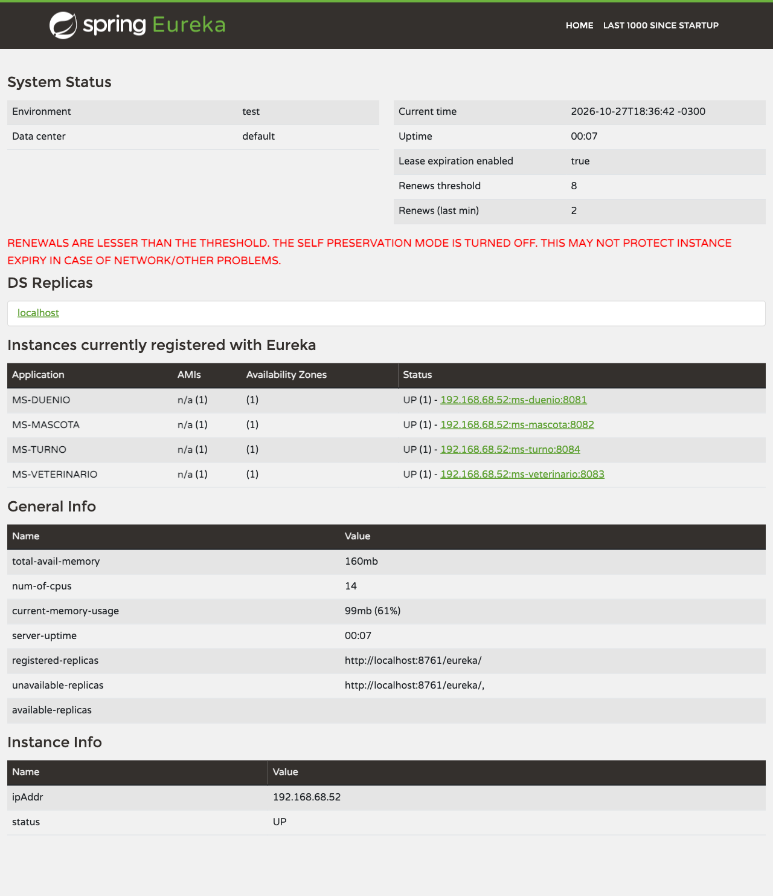

# VetSystem — Microservicios

Segunda fase de VetSystem: el monolito de `vet-system/` se divide en microservicios.
Es un proyecto Maven multi-módulo (`pom.xml` padre con `packaging` `pom`), y cada microservicio es un módulo con su propia base de datos.

| Componente | Puerto | Base de datos | Rol |
| --- | --- | --- | --- |
| config-server | 8888 | — | Configuración centralizada, leída del repo [vetSystem-config](https://github.com/marttinm/vetSystem-config) |
| eureka-server | 8761 | — | Service Discovery: registro y localización de los servicios |
| ms-duenio | 8081 | duenio_db | CRUD de dueños |
| ms-mascota | 8082 | mascota_db | CRUD de mascotas (referencia al dueño por `duenioId`) |
| ms-veterinario | 8083 | veterinario_db | CRUD de veterinarios |
| ms-turno | 8084 | turno_db | Turnos y regla de solapamiento (referencias por `mascotaId` y `veterinarioId`) |

Los microservicios no comparten base: las relaciones entre contextos se guardan como IDs (`Long`), sin `@ManyToOne` ni foreign keys cruzadas.

## Cómo levantarlo

Requiere Java 21, Maven y PostgreSQL corriendo en `localhost:5432`.

1. Crear las bases de datos (una sola vez):

   ```bash
   createdb duenio_db
   createdb mascota_db
   createdb veterinario_db
   createdb turno_db
   ```

2. Compilar todos los módulos desde esta carpeta:

   ```bash
   mvn clean package
   ```

3. Levantar cada componente en su propia terminal, **en este orden**:

   ```bash
   mvn spring-boot:run -pl config-server    # 1. tiene que estar UP antes que todos
   mvn spring-boot:run -pl eureka-server    # 2. tiene que estar UP antes que los microservicios
   mvn spring-boot:run -pl ms-duenio        # 3. los microservicios, en cualquier orden
   mvn spring-boot:run -pl ms-mascota
   mvn spring-boot:run -pl ms-veterinario
   mvn spring-boot:run -pl ms-turno
   ```

   Si un microservicio arranca antes que el Config Server no obtiene su configuración (base de datos, JPA, Eureka, Actuator). Si arranca antes que Eureka no se puede registrar, pero reintenta solo.

   El usuario y la contraseña de PostgreSQL se toman de `DB_USERNAME` y `DB_PASSWORD`, igual que en el monolito.

4. Verificar:

   - Dashboard de Eureka: http://localhost:8761 (tienen que aparecer los cuatro microservicios en UP)
   - Configuración que entrega el Config Server: http://localhost:8888/ms-duenio/default
   - Swagger de cada microservicio: `http://localhost:<puerto>/swagger-ui/index.html`
   - Actuator: `http://localhost:<puerto>/actuator/health` y `/actuator/info`



## Configuración centralizada

Cada microservicio solo tiene en su `application.yml` el nombre, el puerto y la dirección del Config Server:

```yaml
spring:
  application:
    name: ms-duenio
  config:
    import: "optional:configserver:http://localhost:8888"
```

El resto viene del repositorio [vetSystem-config](https://github.com/marttinm/vetSystem-config):

- `application.yml`: configuración compartida (URL de Eureka).
- `ms-<nombre>.yml`: base de datos, JPA, endpoints de Actuator expuestos (`health`, `info`, `metrics`, `env`, `beans`, `mappings`) y datos de `/actuator/info`.

## Comunicación entre microservicios

Al registrar un turno, `ms-turno` valida que la mascota y el veterinario existan llamando a `ms-mascota` y `ms-veterinario` con **OpenFeign**. Los clientes usan el nombre con el que cada servicio se registra en Eureka (`@FeignClient(name = "ms-mascota")`), así que no hay IPs ni puertos hardcodeados: Spring Cloud LoadBalancer resuelve el nombre contra Eureka en cada llamada.

```text
POST /api/turnos
  -> TurnoController
  -> TurnoServiceImpl
       |- MascotaServicePort.existsById      -> MascotaFeignAdapter     -> GET ms-mascota/api/mascotas/{id}
       |- VeterinarioServicePort.existsById  -> VeterinarioFeignAdapter -> GET ms-veterinario/api/veterinarios/{id}
       '- TurnoRepositoryPort.save           -> turno_db
```

- El dominio solo conoce los puertos `MascotaServicePort` y `VeterinarioServicePort`; los adaptadores Feign (`adapter.out.feign`) los implementan y traducen el 404 remoto a `false`.
- `ms-turno` define sus propias clases reducidas `MascotaResponse` y `VeterinarioResponse`: los microservicios no comparten clases de dominio.
- Los timeouts (`connect-timeout` 3 s, `read-timeout` 5 s), la compresión y el logging de Feign están en `ms-turno.yml` del repo de configuración.

| Caso | Respuesta de `POST /api/turnos` |
| --- | --- |
| Mascota y veterinario existen | 201, turno `PENDIENTE` |
| La mascota no existe | 404 `Mascota no encontrada: <id>` |
| El veterinario no existe | 404 `Veterinario no encontrado: <id>` |
| `ms-mascota` o `ms-veterinario` caído | 503 `Servicio remoto no disponible: ...` |

Para probar el flujo completo, el orden de arranque es: config-server → eureka-server → ms-mascota → ms-veterinario → ms-turno.

## Arquitectura

Cada microservicio sigue la arquitectura hexagonal (Ports & Adapters), organizada en tres zonas:

| Capa | Paquete | Clases de ms-duenio |
| --- | --- | --- |
| Dominio | `domain.model` | `Duenio` |
| Dominio | `domain.port.in` | `DuenioService` (interface) |
| Dominio | `domain.port.out` | `DuenioRepositoryPort` (interface) |
| Dominio | `domain.exception` | `DuenioNotFoundException`, `DuplicatedEmailException` |
| Aplicación | `application` | `DuenioServiceImpl` |
| Adaptador de entrada | `adapter.in.web` | `DuenioController`, `GlobalExceptionHandler`, `ErrorResponse` |
| Adaptador de entrada | `adapter.in.web.dto` | `DuenioRequest`, `DuenioResponse`, `DuenioMapper` |
| Adaptador de salida | `adapter.out.persistence` | `DuenioJpaRepository` |

`ms-mascota`, `ms-veterinario` y `ms-turno` repiten la misma estructura con sus propias clases.

- **Dominio**: la entidad y los puertos, que son las interfaces que dicen *qué* necesita el dominio sin decir *cómo*. No depende de Spring.
- **Aplicación**: `DuenioServiceImpl` implementa el puerto de entrada y usa el puerto de salida. Valida que no se repita el email antes de guardar.
- **Adaptadores**: traducen entre el mundo externo y el dominio. El controller recibe HTTP y lo convierte en llamadas al puerto de entrada; `DuenioJpaRepository` implementa el puerto de salida con Spring Data JPA.

### Regla de dependencias

Las dependencias apuntan siempre hacia adentro: los adaptadores conocen al dominio a través de los puertos, y el dominio no conoce a los adaptadores.

- `DuenioServiceImpl` no importa nada de `adapter.*`.
- `DuenioController` no importa `DuenioServiceImpl` ni `domain.model`: solo conoce los DTOs y la interface `DuenioService`.

### ¿Por qué el controller no usa `DuenioServiceImpl`?

Porque el controller es un adaptador y tiene que depender del puerto (`DuenioService`), no de una implementación concreta. Spring inyecta la implementación que haya registrada, así que se puede cambiar `DuenioServiceImpl` por otra (o por un mock en un test) sin tocar el controller. Si el controller importara la clase concreta, la capa externa quedaría atada a un detalle de la capa de aplicación y se rompería la regla de dependencias.
